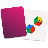
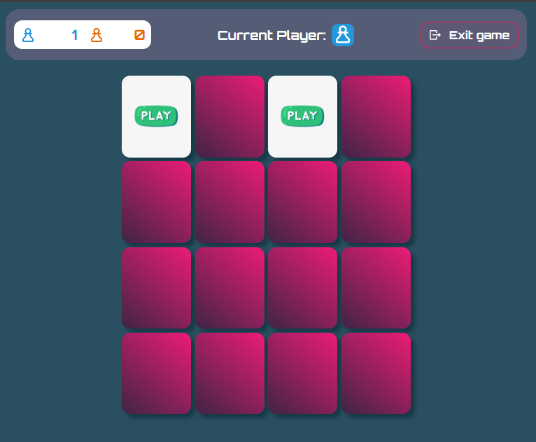
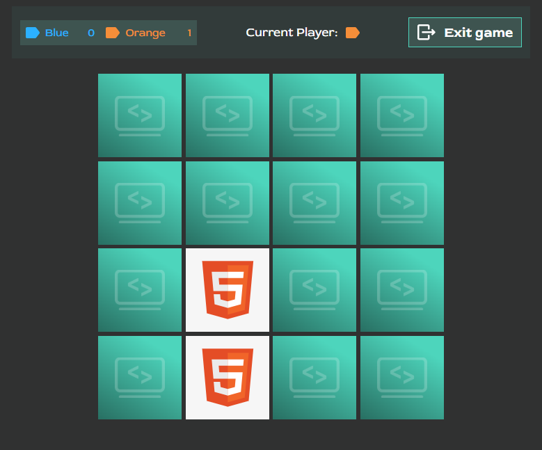
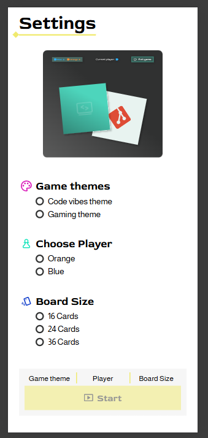

<h1>&nbsp;&nbsp;Memory</h1>

A browser-based memory game with selectable themes, players, and board sizes.

[Play the game here](https://memomemory.netlify.app/)

## Designs

The game is available in two designs:

<table>
  <tr>
    <td align="center"><br><strong>Gaming</strong></td>
    <td align="center"><br><strong>Code Vibes</strong></td>
  </tr>
</table>

## Responsive and installable

Play wherever you are: the game adapts to your screen and can be installed on your device for easy access.

<p align="center">
  
</p>

## Getting started

### Requirements

- [Node.js](https://nodejs.org/)
- npm

### Download and run

```bash
git clone https://github.com/c-bakis/memory.git
cd memory
npm install
npm run dev
```

Open the local URL printed by Vite in your browser.

### Production build

```bash
npm run build
npm run preview
```

## Author

c-bakis

## License

This project is licensed under the MIT License. See [LICENSE](./LICENSE) for details.
